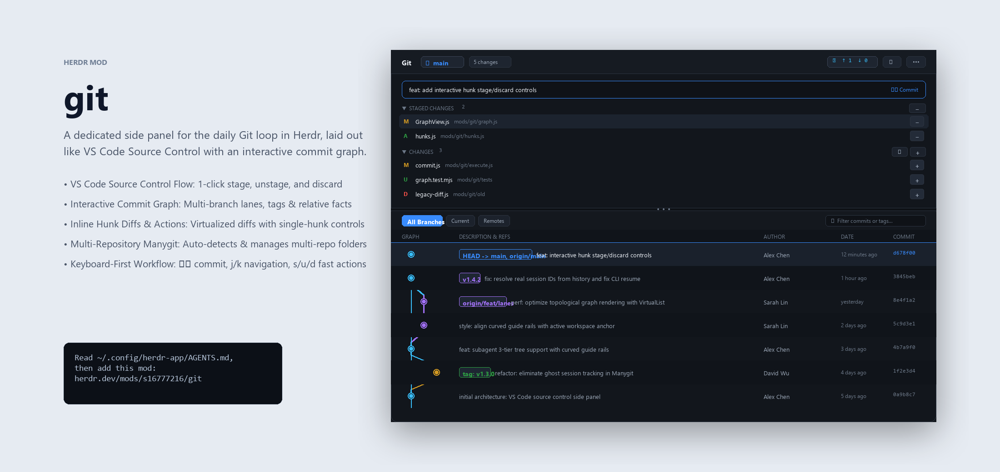

# herdr-git

A side panel for the daily Git loop in [Herdr](https://herdr.dev), laid out like VS Code's Source Control view with an interactive visual commit graph kept underneath.



## Highlights

- **VS Code Source Control Flow**: Top half stages, unstages, and discards files (`M`, `A`, `U`, `D`, `!`), writes commit messages (`⌘⏎`), and syncs with remotes.
- **Visual Commit Graph**: Bottom half renders branch lanes, commit tags, detached HEAD states, authors, relative timestamps, and commit details.
- **Inline Hunk Diffs & Actions**: Clicking a changed file inspects its diff with single-hunk **Stage**, **Unstage**, and **Discard** pill buttons.
- **Multi-Repository Auto-Detection (Manygit)**: Opening a folder holding several repositories automatically lists and manages them.
- **Comprehensive Stash & Sync**: 1-click fast-forward pull/push, diverged branch merge/rebase prompts, and stash list / apply / pop / drop.
- **Keyboard-First Navigation**: Full arrow / `j k` / `Home End` movement, `s` to stage, `u` to unstage, `d` to discard, and `m` for contextual Git actions.

---

## Installation

### With an AI Coding Agent (Recommended)

Ask your Coding Agent (Antigravity, Claude Code, Codex, Cursor, etc.):

```text
Read ~/.config/herdr-app/AGENTS.md,
then add this mod:
herdr.dev/mods/s16777216/git
```

### Manual Installation

1. Copy the `mods/git` directory into your Herdr configuration folder:
   ```sh
   # macOS / Linux
   cp -r mods/git ~/.config/herdr-app/mods/

   # Windows (PowerShell)
   Copy-Item -Recurse -Force mods/git ~/.config/herdr-app/mods/
   ```

2. Verify the mod in Herdr:
   ```sh
   herdr-app check mods/git
   ```

3. Configure `git` in your Herdr layout (e.g., `layouts/main.json` or your custom layout):
   ```json
   {
     "id": "changes",
     "type": "block",
     "content": {
       "mod": "git"
     }
   }
   ```

---

## Architecture & Controls

| Component | Function |
|---|---|
| **Header** | Current branch tag, repository switcher, ahead/behind sync indicator (`↑N ↓N`), refresh button |
| **Commit Box** | 32px message input (`⌘⏎` commits), commit button (auto-stages when empty) |
| **Changes Groups** | Conflicted (`!`), Staged, and Changes groups with hover action buttons |
| **Divider** | Drag to resize split between Changes and Commit Graph (double-click resets to 50%) |
| **Commit Graph** | Multi-branch topological graph with lanes, All/Current toggles, and commit context menu |
| **Diff Viewer** | Virtual list diff view with hunk-level stage/discard controls |

---

## License

MIT © [s16777216](https://github.com/s16777216). Forked from [rabeeh-ta/herdr-git-graph](https://github.com/rabeeh-ta/herdr-git-graph).
